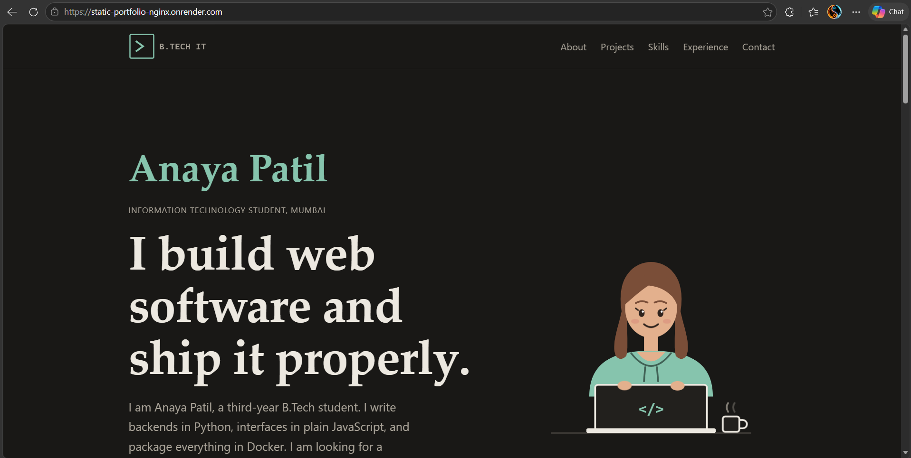
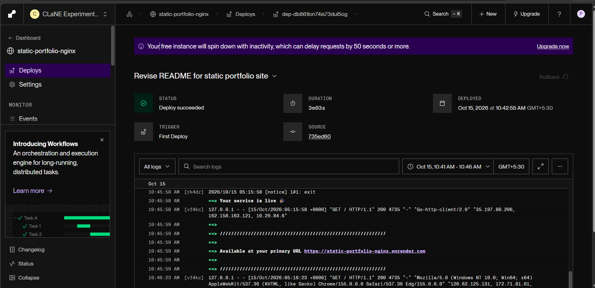
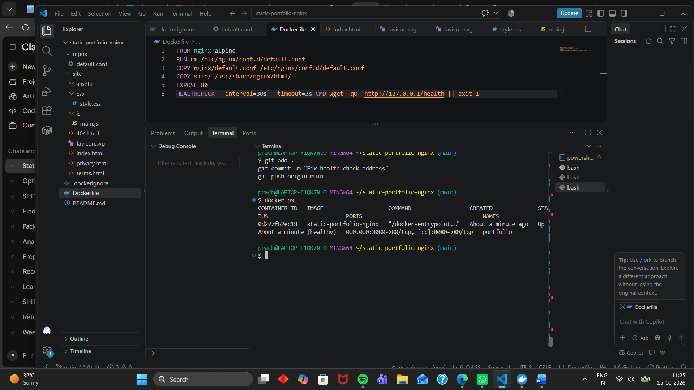
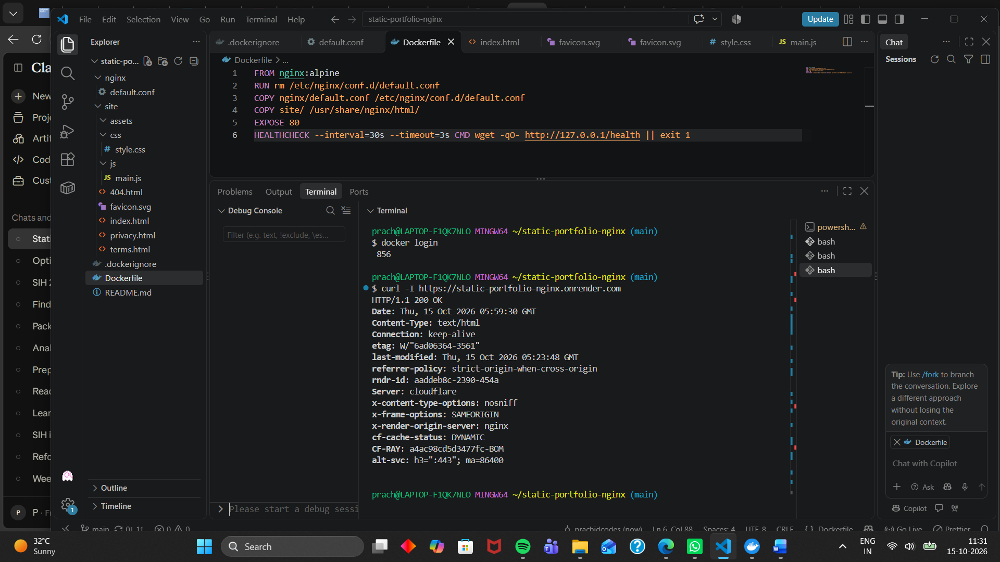
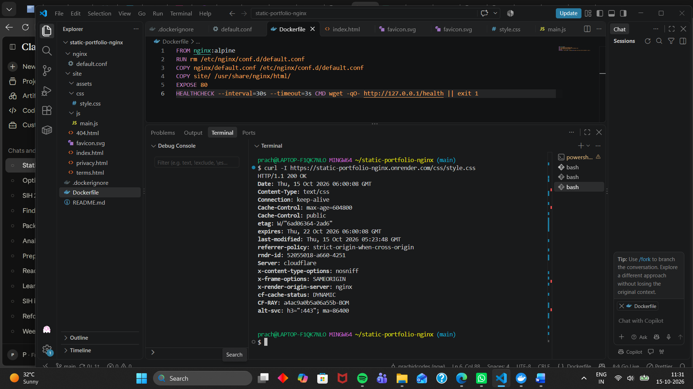
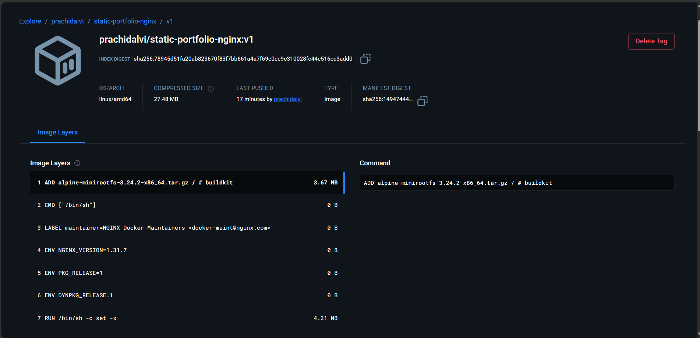

# Static Portfolio Site with Nginx

A lightweight portfolio website served by Nginx inside a Docker container.

**Live site:** https://static-portfolio-nginx.onrender.com/

## Architecture
HTML, CSS and JavaScript in `site/`, bundled into the official `nginx:alpine`
image with a custom server block in `nginx/default.conf`.

## Nginx configuration
- gzip compression for text assets
- 7 day cache lifetime for static files
- security headers on every response
- custom 404 page
- `/health` endpoint for container health checks

## Run locally
    docker build -t static-portfolio-nginx .
    docker run -d -p 8080:80 --name portfolio static-portfolio-nginx

Then open http://localhost:8080

## Deployment
Deployed on Render from this repository's Dockerfile.
Docker Hub: https://hub.docker.com/r/prachidalvi/static-portfolio-nginx

## Screenshots

### Live site

### Deployed on Render

### Container running and healthy

### Response headers from the live URL

### Image on Docker Hub

